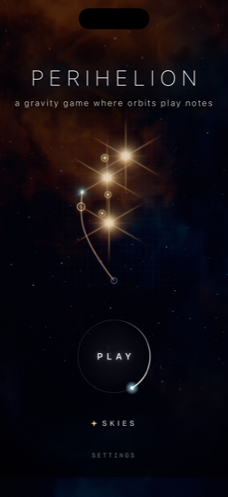
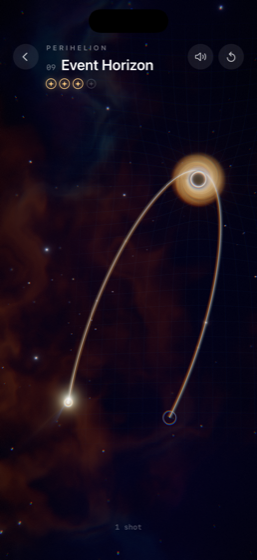
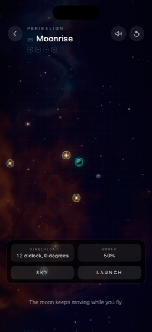

# Perihelion

[](https://github.com/nevzorov46/Perihelion/actions/workflows/ci.yml)

A gravity-assist puzzle for iPhone where orbits play notes.

<p align="center">
  
  
  
</p>

Pull back, let go, and a comet flies through a star system under real Newtonian gravity. Collect every mote of light in one shot. Every close pass of a star or planet rings a note and taps the Taptic Engine; every mote climbs a pentatonic scale. A clean run ends on a rising phrase.

Swift 6, Metal, SwiftUI, AVAudioEngine, Core Haptics. No dependencies, no assets - every pixel and every sound is generated.

## The physics is not faked

- **Restricted N-body.** The comet feels every body; the bodies ignore the comet and ride exact analytic paths: Kepler circles, a binary around its barycentre. Periods come from the masses (ω = √(μ/r³)), never from a designer's slider.
- **The figure-eight three-body solution.** The last campaign sky puts three suns on the Chenciner-Montgomery choreography, integrated from Simó's initial conditions. After one period the table closes to 3·10⁻⁸.
- **Symplectic, fixed-step integrator.** Kick-drift-kick leapfrog at 480 Hz. A circular orbit keeps its energy to 1·10⁻⁸ over the full 16-second flight.

## Levels that prove themselves

Motes are not placed by hand. `tools/run.sh bake` fires shots into each hand-made sky, keeps one whose path meets the level's brief, and drops the motes onto that path. **Every level ships with the shot that made it** - a proof that it can be solved.

Difficulty is measured, not guessed. The tool re-fires the proof shot with the error a hand makes (±0.9° of aim, ±2.4% of power) and counts how many near-misses still win. That fraction is the level's *window*, and the briefs make it shrink as the campaign goes on: 0.83 on the first sky, 0.13 on the three-body one.

## Same bits everywhere

Levels are baked on a Mac and played on a phone, and the simulation is chaotic: a last-bit difference in a moon's position becomes a different trajectory a few seconds later. libm's `sin`/`cos` are not guaranteed to be correctly rounded, so the physics uses its own, built only from `+ − × ÷` (`DMath.swift`), which IEEE-754 makes exact. `tools/run.sh verify` hashes every proof flight's final state into one fingerprint and fails if it is not `e183dc68a2868236`. CI runs it on a GitHub macOS runner, which is the only way that claim means anything: the same number has to come out of hardware that is not mine.

## Rendering

One frame: a baked background (nebula and stars, rendered once per level), a spacetime grid bent by the masses in the vertex shader, trail ribbons, and one instanced draw of every sprite - stellar granulation, lit planets, an accretion disk - into an `rgba16Float` target. Then a 13-tap downsample / tent upsample bloom (Jimenez 2014), AgX tonemapping and an sRGB drawable. Dynamic buffers are cycled three-deep behind a semaphore, so the CPU never writes into memory the GPU is reading.

AgX rather than ACES because the sky is mostly one bright thing on black, which is exactly where the Narkowicz ACES fit skews: a blue-white star clipped towards cyan as it saturated. AgX desaturates into the highlight instead, so a star burns out to white.

Comet tails are built the way a real one is, not from a particle emitter. Dust is released continuously in columns of nine grains spanning β = 0.02 … 0.9, and the sheet those grains sweep out is stitched into a mesh: its rows are syndynes and its columns synchrones, as in Finson and Probstein's 1968 model. Brightness follows grain density, so the tail dims exactly where it stretches. The ion tail is separate, five filaments blown anti-sunward with travelling kinks and velocity aberration.

## Feel

Each close pass is a note and a tap, and the pull itself is a continuous hum that swells as the comet dives in and snaps off at the closest point.

The hum was wrong for months and nobody could tell, because Core Haptics does not run in the simulator: the first time the game reached a phone there was no vibration at all. `tools/run.sh feel` replays every level's proof shot and reports what a player would feel, which found it. The hum was keyed to absolute pull, from 1617 up to 6000, but across the campaign the peak pull spans a factor of seven hundred - 189 on the first sky against 129563 at the black hole - so the first two levels could never cross the threshold and the black hole saturated instantly.

The measure is now `(surface radius / distance)²`, which is the pull divided by the same body's pull at its own surface. The mass cancels, so the number means the same thing on a moon and on a black hole, and each sky is scaled against its own closest approach, replayed from its proof shot when the level loads.

## Playable without seeing it

Aiming is a drag back from the comet. A drag carries the angle and the power and says neither out loud, so with VoiceOver the game was a black screen that made noises.

With VoiceOver running the field offers the same two numbers as controls the rotor can turn, each speaking its value: direction as a clock face and in degrees, power as a percentage. A **Sky** button reads out where the bodies and the motes are, as clock positions and rough distances from the launch point, because aiming is no use without knowing what you are aiming at. Adjusting the aim plays its note too, pitch climbing with the bearing and loudness with the power, so there is feedback that is not speech.

The clock face needs no conversion: the field transform puts world +x up the screen and world +y to the right, so a shot's world angle already is a bearing measured clockwise from straight up.

Also: **Reduce Motion** removes the camera shake and the screen-space ripple of a shockwave, keeping the flare that marks the moment without moving the frame. **Dynamic Type** scales the HUD, capped at 1.6 so text over a live field cannot cover the thing it describes. **Differentiate Without Color** fills collected motes instead of only tinting them. Vibration and sound each have a switch, and Settings says which of the four reasons is behind "no vibration" rather than leaving a switch that claims to be on while nothing happens.

## Swift 6

The whole app builds in Swift 6 language mode with no warnings. Most of it was free, because the concurrency was already real: `GameSession` says in its own comment that it lives on the main thread and is advanced by the renderer's frame callback, and that is now `@MainActor` instead of a promise.

It also caught a genuine bug. Marking `Synth` as `@MainActor` made the audio render block inherit the main actor, and the runtime executor check trapped on the audio thread. The block is now built in a `nonisolated` factory, so the boundary is structural rather than a comment, and the same for the Core Haptics handlers and the recording tap. One transfer stays genuinely unsafe - the tap hands an `AVAudioPCMBuffer` over from the audio thread, and neither it nor `AVAudioFile` is `Sendable` - so it lives in one named type with the argument for why it is sound written next to it.

## Sound

An FM synth in an `AVAudioSourceNode`. The game talks to the audio thread through a lock-free single-producer/single-consumer ring (`Synchronization.Atomic`): no locks and no allocation on the render thread. Which note each body sings comes from its mass, after Kepler's *Harmonices Mundi*: heavier is lower, and collected motes climb the scale.

## Tools

The physics compiles on its own, without the app, so it can be checked and measured from the command line.

```bash
tools/run.sh verify   # integrator, trig, every level's proof shot, the fingerprint
tools/run.sh bake     # regenerate the campaign
tools/run.sh feel     # what the player feels, per level, for the haptic curve
tools/run.sh icon     # draw the app icon from a real trajectory
```

The icon is not an illustration of the game: `tools/run.sh icon` runs a level's proof shot and draws the curve the integrator produced, framed on the perihelion.

## Running

Xcode 26, iOS 18, iPhone.

```bash
open Perihelion.xcodeproj
```

Launch arguments, for checking things and for footage:

```bash
xcrun simctl launch booted com.nevzorov.Perihelion -demo YES          # plays itself
xcrun simctl launch booted com.nevzorov.Perihelion -level binary      # one sky
xcrun simctl launch booted com.nevzorov.Perihelion -clean YES         # no overlays
xcrun simctl launch booted com.nevzorov.Perihelion -aimControls YES   # the VoiceOver strip, without VoiceOver
```

## What is not done

- **No performance numbers from a device yet.** The game holds 60 fps on the title screen of an iPhone 13 mini, measured with Instruments, and the thermal state stays nominal, but that is ten seconds of an attract loop rather than a campaign. Frame timings under real play, the memory ceiling and the behaviour under thermal pressure are unmeasured, and the simulator cannot answer any of them: its Metal path is not a tile-based GPU.
- **The haptic curve has not been felt.** Its shape is chosen from the measurements in `tools/run.sh feel`, which can say how long the hum lasts but not whether it feels good.
- **The first sky has no star to pass**, so it has no comet tail and nothing to hear at perihelion. It teaches aiming and nothing else.
- **The camera** pulls in during flight and leads the comet, and it is still not right.
